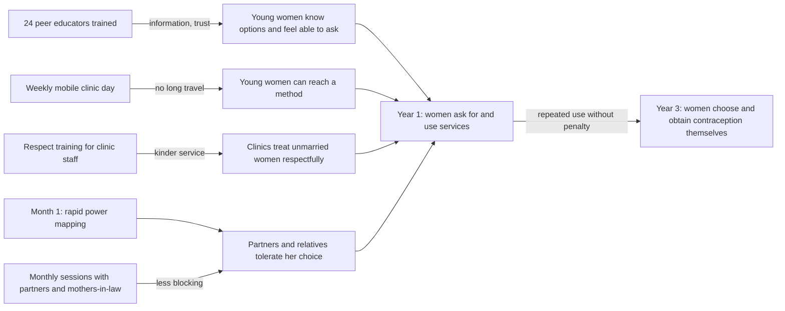

**Main pathway:** peer educators, mobile clinic days, respectful-care training and sessions with partners and mothers-in-law should together let young women choose and obtain contraception without shame or permission. The riskiest assumption is that the people who now give or withhold permission (partners, mothers-in-law, other relatives) will accept young women's own decisions. No one has tested this, and the MA has no analysis yet of who holds power.

**Assumptions we made to fill gaps:** project start is month 0, and "decide for themselves" means a woman chooses her own method or none. We assume the 40 interviews gave no data on partners' or mothers-in-law's views. Nothing here is a finding.

## Vision
By the end of year 3, young women aged 15-24 in the two settlements decide for themselves whether and when to use contraception, and can get it without shame or permission from a partner or relative.

## Context and population
About 9,000 young women live in the two settlements. Many left school early, work informally and rely on a partner or relative for money and permission to travel. The nearest public clinic is a 40-minute walk or a costly bus ride, and staff are often unkind to unmarried women who ask for contraception.

The MA holds 40 interviews and no earlier theory of change. The project cannot change national law or fund transport, so it must bring services closer and change how people treat these young women.

## Pathway diagram

Read the main pathway like this: trained peers, a nearby mobile clinic, kinder clinics and more tolerant partners and relatives lead women to ask for and use services, and sustained use without penalty lets them choose for themselves.

## Preconditions by horizon (a precondition is a change that must happen first)
| Short (by month 12) | Medium (year 2-3) | Long (end of year 3) |
|---|---|---|
| Month 1: rapid power mapping done | Women use mobile and clinic services at rising rates | Women decide on contraception themselves |
| Peer educators trained and trusted | Women report respectful care | They obtain it without shame or third-party permission |
| Mobile clinics run weekly | Partners and relatives attend and stop blocking | |
| Clinic staff trained | | |

## Causal claims and assumptions
| From → To | Causal claim | Assumption | Evidence status |
|---|---|---|---|
| Peers → knowledge and confidence | Women trust peers more than outsiders | Peers reach the most isolated women, not only well-connected ones | Plausible (Vogel 2012 asks for named mechanisms; none shown here) |
| Mobile clinic → access | Removing the 40-minute trip removes the main barrier | Women can visit without being seen or stopped, and stock is reliable | ⚠️ Untested mechanism |
| Training → respectful care | Trained staff treat unmarried women kindly | A course changes behaviour without management support | ⚠️ Untested mechanism |
| Sessions → permission | Visible discussion makes partners and relatives less likely to block | They attend and the women's own power changes | ⚠️ Untested mechanism (riskiest) |
| Short-term changes → use | Information, access, respect and tolerance together enable choice | All four arrive; one missing may be enough to stop use | Untested |
| Use → autonomy | Repeated use without penalty shifts power at home | Money and travel control change, which the project cannot fund | Untested |

## Feminist political economy analysis
| Node | Interests served | Interests threatened | Power shift needed | Voices (who defined it, who was not heard) | Backlash risk and how the project reduces it |
|---|---|---|---|---|---|
| Peers and mobile clinic | Young women | Possibly partners and relatives who control mobility | Women move and ask without permission | 40 young women interviewed; partners, relatives, clinic staff not heard | Partners may restrict movement. Monthly sessions make the clinic visible and discussed, not hidden |
| Respectful care | Young women, clinic managers | Staff who judge unmarried women | Staff see service as a right | Staff not consulted | Staff may resist. Training with managers present lowers this |
| Partners and mothers-in-law | Possibly household stability | Their control of money and permission | Decision shifts to the woman | Their own views unknown | Violence risk if a woman is seen to defy them. Safe referral and a no-names rule needed |
| Women's autonomy | Young women | Whoever gains from dependence | Women gain income and say | Out-of-school and disabled young women likely missing | As above |

⚠️ Feminist political economy analysis missing: nobody has mapped who decides, who benefits, who can block and which voices are absent. Milestone: **Month 1: rapid power mapping**, with short interviews of partners, mothers-in-law, clinic managers and out-of-school women.

## Threats to the ToC
Other explanations could account for any change without the project: new NGO or government outreach, a new clinic or free-contraception campaign, national economic shifts that change work and income, and social-media norm change among young people. Mayne (2019) asks us to name these and check whether they fit the data better than our project does.

## Contribution question
To what extent and in what ways did the project contribute to young women's own decisions about contraception, given other contributions and context?

## Evidence plan (untested first)
| Assumption | Confirming | Disconfirming | Source | Revisit | If it fails |
|---|---|---|---|---|---|
| Partners and relatives accept her choice | Fewer reports of blocked visits | Same or more blocking, or any rise in violence | Women's interviews (safe setting), session records | Month 6, month 12 | Add home visits with mothers-in-law |
| Women can use the mobile clinic unseen | Steady attendance by unmarried women | Attendance drops or only married women come | Clinic logs, exit talks | Month 6 | Move times, add private entrance |
| Course changes staff behaviour | Women report respect; staff observed kind | Same complaints | Exit interviews, mystery visits | Month 12 | Add manager coaching |
| Weekly day plus stock is enough | Methods available at each visit | Stock-outs, long queues | Stock records | Month 6 | Add days or partner clinic |
| Peers reach isolated women | Out-of-school women reached | Only well-connected women reached | Peer logs | Month 6 | Change recruitment |
| Autonomy follows use | Women report more say | Money and travel stay controlled | Year 3 interviews | End year 3 | Redesign livelihoods link |

## Data gaps
⚠️ Data gap: views of partners, mothers-in-law, clinic staff — they hold the power the pathway depends on — run the month 1 power mapping.
⚠️ Data gap: current contraceptive use and unmet need — no baseline to show change — add baseline in months 1-3.
⚠️ Data gap: what happens to women who defy relatives — backlash risk unknown — add safety and referral protocol.

## What this ToC cannot tell you
1. Most assumptions are untested, so the pathway is a hypothesis, not a finding.
2. No stakeholder consultation has tested this draft yet.
3. Partners, mothers-in-law, clinic staff, out-of-school and disabled young women were not heard in defining the outcome.
4. It may not hold outside these two settlements, this city or this policy setting.
5. Asking about violence, abortion or sexual orientation needs consent, privacy and referral first. Never ask where a woman may be overheard.

## Sources
Vogel, I. (2012) *Review of the Use of 'Theory of Change' in International Development*, UK DFID. [GOV.UK](https://www.gov.uk/research-for-development-outputs/review-of-the-use-of-theory-of-change-in-international-development-review-report). Used for explicit assumptions and named mechanisms.
van Eerdewijk, A., Wong, F., Vaast, C., Newton, J. et al. (2017) *White Paper: Conceptual Model of Women and Girls' Empowerment*, KIT. [KIT page](https://www.kit.nl/institute/publication/white-paper-conceptual-model-of-women-and-girls-empowerment/). Used for empowerment as changing power relations.
Mayne, J. (2019) "Revisiting contribution analysis", *Canadian Journal of Program Evaluation* 34(2), 171-191. [Journal page](https://ces.journals.uvic.ca/index.php/cjpe/article/view/284). Used for rival explanations and the contribution question.

Searched 11 Oct 2026: no newer edition of any of these three found.

*AI-use line: AI drafted this theory of change. A named person must check sources and figures before it goes to the donor.*

**Verification:** rung 2 for the three citations (searched this session). The draft was not read against the needs assessment, which I do not have. I did not count words. The tables put it above 1,200, so cut the Threats and Data gaps lines first if the donor enforces the limit.
